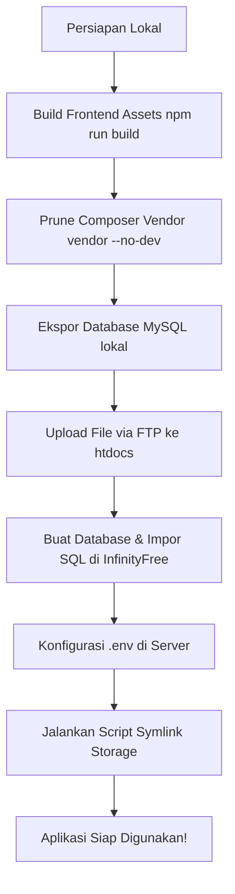

# Panduan Deployment Laravel ke InfinityFree

Dokumen ini berisi panduan langkah demi langkah untuk menyebarkan (deploy) aplikasi **POS Kasir Makanan** Anda ke **InfinityFree** (shared hosting gratis). 

Karena Laravel dirancang untuk server dengan akses SSH (Terminal), ada beberapa penyesuaian khusus yang harus dilakukan saat mendeploy ke shared hosting seperti InfinityFree yang hanya menyediakan akses FTP dan phpMyAdmin.

---

## Ringkasan Alur Deployment



---

## Langkah 1: Persiapan di Komputer Lokal (Local)

Sebelum mengunggah file, kita perlu menyiapkan file agar siap berjalan di lingkungan produksi (production).

### 1. Jalankan Build Assets (Vite)
Aplikasi ini menggunakan Vite dan Tailwind CSS. Anda harus melakukan kompilasi file aset CSS dan JS terlebih dahulu agar berjalan optimal di produksi.
Jalankan perintah berikut di terminal lokal Anda:
```bash
npm run build
```
Perintah ini akan menghasilkan folder `public/build` yang berisi file CSS & JS produksi. **Pastikan folder ini ada sebelum Anda mengunggah file.**

### 2. Bersihkan Dependensi Development (Composer)
Secara default, folder `vendor` hasil instalasi lokal berisi package untuk pengembangan dan pengujian (seperti PHPUnit, Mockery, dll.).
InfinityFree memiliki **batasan Inode (maksimal 30.000 file)**. Jika Anda mengunggah seluruh folder `vendor` apa adanya, Anda bisa dengan mudah melebihi batas ini.

Untuk menguranginya, bersihkan package development dengan menjalankan perintah ini di terminal lokal Anda:
```bash
composer install --no-dev --optimize-autoloader
```
*Catatan: Jika nanti Anda ingin mengembangkan lagi secara lokal, jalankan saja `composer install` kembali.*

### 3. Ekspor Database Lokal
1. Buka phpMyAdmin lokal Anda (`http://localhost/phpmyadmin`).
2. Pilih database `pos_kasir_makanan`.
3. Klik tab **Export** (Ekspor), lalu klik **Export** untuk mengunduh file `.sql` (misal: `pos_kasir_makanan.sql`).

---

## Langkah 2: Persiapan di Panel InfinityFree

1. Masuk ke **Client Area InfinityFree** Anda.
2. Buka **Control Panel (cPanel)** untuk akun hosting Anda.
3. **Buat Database MySQL Baru**:
   - Masuk ke menu **MySQL Databases**.
   - Buat database baru (misalnya dengan nama belakang `poskasir`). Nama lengkap database akan terlihat seperti `if0_XXXXXXXX_poskasir`.
   - Catat detail database: **DB_HOST**, **DB_NAME**, **DB_USER**, dan **DB_PASSWORD** (sesuai yang tertera di panel kontrol atau yang telah Anda konfigurasikan di file `.env.infinityfree`).
4. **Impor Database**:
   - Buka **phpMyAdmin** dari Control Panel InfinityFree untuk database baru tersebut.
   - Klik tab **Import** (Impor).
   - Pilih file `.sql` yang telah Anda ekspor dari lokal sebelumnya.
   - Klik **Go** / **Import** untuk mengunggah dan menjalankan skema database.

---

## Langkah 3: Mengunggah File ke InfinityFree

Karena InfinityFree tidak memiliki terminal SSH, Anda harus mengunggah file secara manual.

> [!WARNING]
> **JANGAN PERNAH mengunggah folder `node_modules`!** 
> Folder `node_modules` memiliki puluhan ribu file kecil yang akan langsung membuat kuota Inode akun Anda habis/di-suspend, dan folder ini sama sekali tidak dibutuhkan di server hosting karena aset sudah di-compile di langkah sebelumnya.

### Cara Terbaik: Menggunakan FTP (FileZilla)
1. Unduh dan instal [FileZilla Client](https://filezilla-project.org/).
2. Dapatkan kredensial FTP Anda dari panel InfinityFree (FTP Host, FTP Username, FTP Password).
3. Hubungkan FileZilla ke server InfinityFree.
4. Di panel kanan (Server), masuk ke dalam folder **`htdocs`**.
5. Unggah **semua file dan folder** dari proyek lokal Anda ke dalam folder **`htdocs`** tersebut, **KECUALI**:
   - `node_modules/` (Jangan diunggah)
   - `.git/` & `.github/` (Jangan diunggah)
   - `.env` lokal Anda (buat `.env` baru di server nanti)
   - `tests/` (Opsional, tidak perlu diunggah)

*Tips Keamanan & Struktur:*
Folder `htdocs` di InfinityFree akan bertindak sebagai root aplikasi Anda. File `.htaccess` di root proyek Anda sudah diatur untuk otomatis mengarahkan lalu lintas ke folder `public/`, sehingga Anda bisa mengunggah semuanya langsung di dalam `htdocs`.

---

## Langkah 4: Konfigurasi File `.env` di Server

1. Setelah semua file terunggah, cari file bernama `.env.infinityfree` di dalam folder `htdocs` server Anda menggunakan File Manager bawaan InfinityFree atau FileZilla.
2. **Ubah nama (Rename)** file `.env.infinityfree` menjadi **`.env`**.
3. Buka file `.env` tersebut dan pastikan konfigurasinya sudah benar:
   - `APP_ENV=production`
   - `APP_DEBUG=false`
   - `APP_URL=https://poskasir.infinityfreeapp.com` (Ganti dengan domain asli Anda di InfinityFree jika berbeda)
   - Konfigurasi database `DB_HOST`, `DB_DATABASE`, `DB_USERNAME`, dan `DB_PASSWORD` harus sesuai dengan database MySQL yang Anda buat di InfinityFree.
   - Jika Anda memiliki API Key Gemini untuk fitur AI Assistant, isi di bagian `GEMINI_API_KEY`.

---

## Langkah 5: Membuat Symlink Storage (storage:link)

Laravel menyimpan berkas unggahan di `storage/app/public` dan membutuhkan link simbolis (symlink) di `public/storage` agar bisa diakses secara publik oleh web browser. Di server biasa, kita menjalankan `php artisan storage:link`. Di InfinityFree, kita bisa melakukannya menggunakan script PHP sederhana.

Kami telah membuat skrip pembantu otomatis untuk Anda. 

> [!IMPORTANT]
> Skrip pembantu (`storage-link.php` dan `unzip.php`) disimpan di folder **`deploy/`** proyek, **bukan** di `public/`, karena siapa pun bisa menjalankannya tanpa login. Salin ke `public/` di server hanya saat dibutuhkan, lalu segera hapus lagi setelah dijalankan.

### Cara Membuat Symlink secara Otomatis:
1. Buat file baru bernama **`storage-link.php`** di dalam folder **`public`** di server Anda (atau buat secara lokal lalu unggah).
2. Isi file tersebut dengan kode berikut:

```php
<?php
// storage-link.php

$targetFolder = $_SERVER['DOCUMENT_ROOT'] . '/../storage/app/public';
// Jika htdocs adalah DOCUMENT_ROOT Anda:
if (!is_dir($targetFolder)) {
    $targetFolder = dirname(__DIR__) . '/storage/app/public';
}

$linkFolder = $_SERVER['DOCUMENT_ROOT'] . '/storage';
if (!is_dir(dirname($linkFolder))) {
    $linkFolder = dirname(__DIR__) . '/public/storage';
}

if (file_exists($linkFolder)) {
    echo "Folder /public/storage sudah ada.<br>";
} else {
    if (symlink($targetFolder, $linkFolder)) {
        echo "Symlink berhasil dibuat!<br>";
        echo "Dari: $targetFolder<br>";
        echo "Ke: $linkFolder<br>";
    } else {
        echo "Gagal membuat symlink. Silakan hubungi administrator atau buat manual.<br>";
    }
}
```

3. Akses skrip tersebut melalui browser Anda di URL:
   `https://poskasir.infinityfreeapp.com/storage-link.php` (Ganti dengan domain Anda).
4. Jika tertulis **"Symlink berhasil dibuat!"**, maka konfigurasi selesai.
5. **PENTING:** Demi keamanan, segera **HAPUS** file `storage-link.php` dari server setelah berhasil dijalankan agar tidak disalahgunakan oleh pihak lain.

---

## Troubleshooting & Tips Tambahan

* **Error 500 (Internal Server Error)**: 
  Biasanya disebabkan oleh versi PHP yang tidak cocok (pastikan versi PHP di InfinityFree diatur ke **PHP 8.2** atau **PHP 8.3** agar sesuai dengan kebutuhan Laravel 11) atau ada kesalahan penulisan di file `.env`.
* **Error "Database connection refused"**:
  Periksa kembali `DB_HOST` dan `DB_PASSWORD` di `.env`. Host database di InfinityFree bukan `127.0.0.1` atau `localhost`, melainkan nama host khusus seperti `sqlXXX.infinityfree.com`.
* **Mengosongkan Cache**:
  Jika Anda mengubah sesuatu dan ingin membersihkan cache aplikasi tanpa SSH, Anda bisa membuat file `clear-cache.php` di folder `public` dengan kode:
  ```php
  <?php
  require __DIR__.'/../bootstrap/app.php';
  Artisan::call('config:clear');
  Artisan::call('cache:clear');
  Artisan::call('view:clear');
  echo "Cache berhasil dibersihkan!";
  ```
  Lalu akses lewat browser dan segera hapus file tersebut setelah digunakan.
